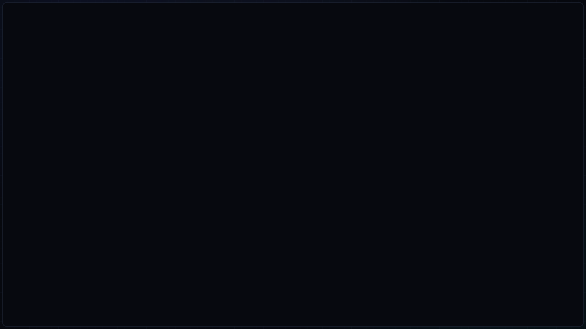

# ◈ CyberDeck — Adaptive Wayland / Hyprland Environment

Кастомное окружение рабочего стола на базе **Hyprland + GTK4 Layer-Shell**, выполненное в единой тактической дизайн-системе Cyber HUD (`#07090f` / `#4c6ef5` / `#22b8cf`).

## 🎬 Полный видеообзор окружения

[](assets/showcase.mp4)

> ▶ **[Открыть полное видео в 1080p 60 FPS (`assets/showcase.mp4`)](assets/showcase.mp4)** — демонстрация анимации бронестворки при входе, фонового стола CyberDeck Hub, OSD уведомлений, тайлинга терминала с Btop и кастомного HUD-браузера Firefox.

## 📸 Скриншоты

### 1. Рабочий стол (CyberDeck Hub)


### 2. Терминал (HUD Rail + Fastfetch)


### 3. Системный монитор (Btop Cyber Theme)


## ⚡ Что входит в окружение

- **Адаптивная сессия `cyberdeck` (`cyberdeck-hw-detect`):** автоматически подстраивается под **ноутбук** (заряд батареи, ватты, профили питания `Баланс / Эко / Турбо`, жесты тачпада, датчик крышки) или **стационарный ПК** (датчик температуры `CPU/GPU °C`, проводной `LAN`, плоский профиль мыши, масштаб HiDPI).
- **Фоновый рабочий стол `CyberDeck Hub`:** открытие каждого приложения на свободном рабочем столе без лимита столов (`1..∞`), живой док активных/фоновых программ со счётчиком окон на верхней панели, закрепление окон поверх остальных с изменением размера (`SUPER + P`), меню аудиоустройств PipeWire и меню Wi-Fi.
- **Кастомный курсор `CyberDeck-Cursor` и иконки `CyberDeck-Icons`:** скомпилированный XCursor (`24 / 32 / 48 px`) с анимацией загрузки и автогенератор векторных SVG-иконок под все установленные `.desktop` приложения.
- **HUD-оформление браузера и терминала:** расширенная векторная тема Firefox (сетка, схемотехнические дорожки и угловые скобы на панели вкладок + орбитальный радар и крылья телеметрии на стартовой странице), непрозрачные темы для `Foot` / `Kitty`, полноширинная HUD-рельса командной строки, а также темы `Fastfetch` и `Btop`.
- **SDDM, анимация перехода и GRUB:** кастомная тема экрана входа SDDM, выдвижная бронестворка при входе в сессию и тема загрузчика `GRUB` в едином стиле.

## 🚀 Быстрая установка (Arch Linux)

```bash
git clone https://github.com/ssOh-v1/CyberDeck.git
cd CyberDeck
./install.sh
```
