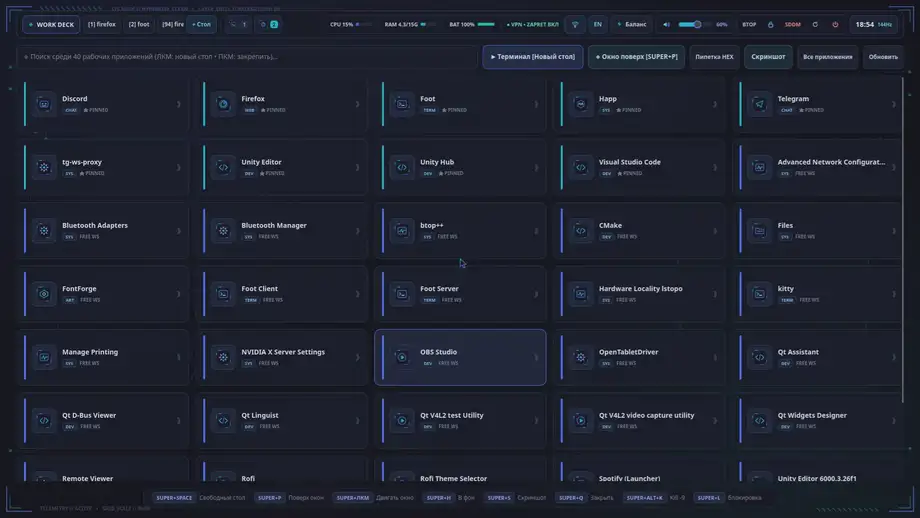
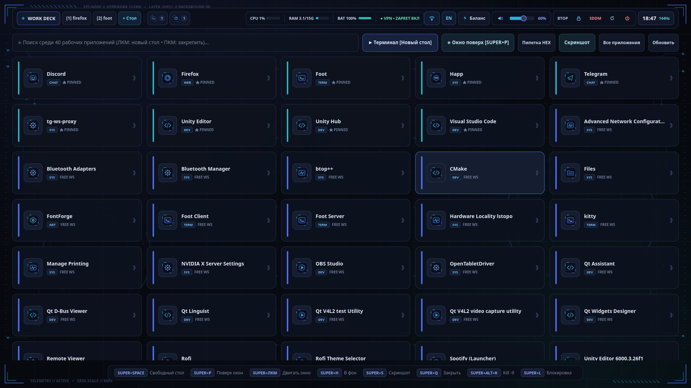
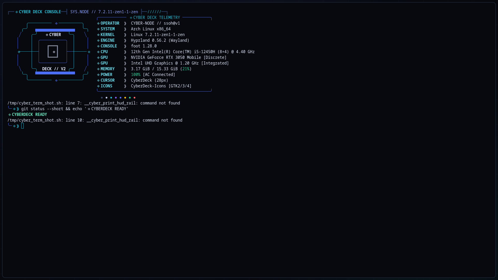

# ◈ CyberDeck — Adaptive Wayland / Hyprland Environment

Кастомное окружение рабочего стола на базе **Hyprland + GTK4 Layer-Shell**, выполненное в единой тактической дизайн-системе Cyber HUD (`#07090f` / `#4c6ef5` / `#22b8cf`).

## 🎬 Полный видеообзор окружения

[](assets/showcase.mp4)

> ▶ **[Открыть полное видео в 1080p (`assets/showcase.mp4`)](assets/showcase.mp4)** — полный неспешный обзор: загрузчик GRUB ➔ экран входа SDDM ➔ выдвижная бронестворка ➔ рабочий стол CyberDeck Hub ➔ декорированные меню Rofi и Wi-Fi ➔ терминал и кибер-проводник ➔ гермостворки экрана блокировки ➔ HUD-браузер Firefox.

## 📸 Скриншоты

### 1. Рабочий стол (CyberDeck Hub)


### 2. Терминал (HUD Rail + Fastfetch)


## ⚡ Что входит в окружение

- **Адаптивная сессия `cyberdeck` (`cyberdeck-hw-detect`):** автоматически подстраивается под **ноутбук** (заряд батареи, ватты, профили питания `Баланс / Эко / Турбо`, жесты тачпада, датчик крышки) или **стационарный ПК** (датчик температуры `CPU/GPU °C`, проводной `LAN`, плоский профиль мыши, масштаб HiDPI).
- **Фоновый рабочий стол `CyberDeck Hub`:** открытие каждого приложения на свободном рабочем столе без лимита столов (`1..∞`), док активных/фоновых программ со счётчиком окон на верхней панели, закрепление окон поверх остальных с изменением размера (`SUPER + P`), декорированные HUD-меню приложений Rofi и беспроводных сетей Wi-Fi.
- **Кибер-проводник, курсор `CyberDeck-Cursor` и иконки `CyberDeck-Icons`:** тёмная HUD-стилизация файловых менеджеров (`GTK3 / GTK4`) с кастомными векторными иконками папок и файлов, скомпилированный XCursor (`24 / 32 / 48 px`) и автогенератор SVG-иконок под все установленные программы.
- **Экран блокировки с гермостворками (`cyber-lock`):** парные бронестворки со световым швом и гидравлическими замками при уходе в блокировку и разблокировке + декорированный терминал `hyprlock` с криптографическими крыльями и радаром.
- **HUD-оформление браузера, терминала, SDDM и GRUB:** расширенная векторная тема Firefox, непрозрачные темы для `Foot` / `Kitty` с полноширинной HUD-рельсой и `Fastfetch`, экран входа `cyberdeck-sddm` и загрузчик `cyberdeck-grub`.

## 🚀 Быстрая установка (Arch Linux)

```bash
git clone https://github.com/ssOh-v1/CyberDeck.git
cd CyberDeck
./install.sh
```
